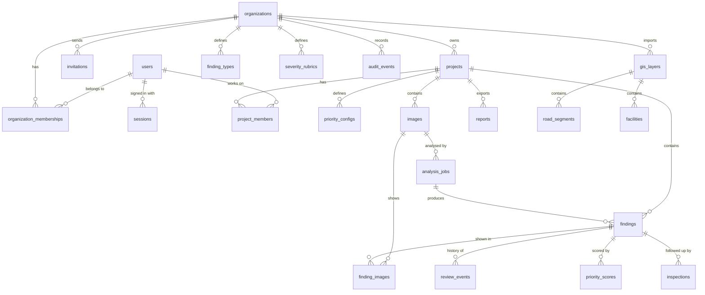

# Database Design (P2)

**Status:** Approved by owner and **frozen**, 2026-10-14. Later changes go through change control (`02-process/development-model.md`).

## In plain words

The database is the app's **memory**. It is a set of **tables**, like spreadsheets:
- each **table** holds one kind of thing (users, projects, photos, findings…),
- each **row** is one item (one photo),
- each **column** is one piece of information about it (when the photo was taken).

Tables point to each other. A photo row says which project it belongs to; a finding row says which photo it came from.
This document lists every table, what it stores, and the rules that protect the data.

---

## 1. Design rules (apply to every table)

| Rule | What it means | Why |
|------|---------------|-----|
| Random IDs | Every row's ID is a long random code (UUID), not 1, 2, 3… | Nobody can guess the next ID. Every request is still permission-checked. |
| Timestamps | Every table has `created_at`; changeable tables also have `updated_at`. Times are stored in UTC. | Know when things happened |
| Organization boundary | Organization-level tables have `organization_id`. Everything else belongs to a project, which belongs to an organization. | Every query can be limited to the user's organization |
| Facts, not permissions | Tables store who holds which role, never "what a role may do". | Permissions can change in code without touching data (`03-requirements/permission-matrix.md` §6) |
| Text + allowed list | Roles and statuses are text with a list of allowed values (a `CHECK` rule), not a fixed database type. | Easy to add values later |
| Never overwrite originals | Original AI results and original locations are written once and never changed. Corrections go in separate columns. | Spec requirement (FR-33) |
| No hard deletes | Things are archived or withdrawn (marked with a date), not deleted. Real deletion only follows the retention policy (PI-13). | Data safety (NFR-03) |
| History is append-only | Review events and audit events are only ever added, never edited or deleted. | Trustworthy history |
| Versioned settings | Rubrics and priority settings are saved as numbered versions. Records point to the version they used. | Settings can change without rewriting old records (`03-requirements/partner-inputs.md` §3) |
| Locations | Points and areas are stored as PostGIS geometry in WGS 84 (EPSG:4326, normal latitude/longitude). Distances are calculated in meters. | Standard GPS format; correct distances |

---

## 2. Overview diagram

---

## 3. Tables

Column types in plain words: `uuid` = random ID · `text` = words · `int` = whole number · `numeric` = decimal number · `bool` = yes/no · `timestamptz` = date and time · `jsonb` = a small structured note · `point` / `polygon` / `line` = map shapes (PostGIS).

### 3.1 People and access (built in P3)

**`organizations`**: a customer (e.g. a city road department).
| Column | Type | Notes |
|--------|------|-------|
| id | uuid | |
| name | text | required |
| created_at | timestamptz | |

**`users`**: a person who can sign in.
| Column | Type | Notes |
|--------|------|-------|
| id | uuid | |
| email | text | required, unique (case-insensitive) |
| full_name | text | |
| password_hash | text | Argon2 hash; the password itself is never stored |
| is_active | bool | false = cannot sign in (deactivated, not deleted) |
| last_login_at | timestamptz | |
| created_at, updated_at | timestamptz | |

**`organization_memberships`**: which organization a person belongs to, and their organization role.
| Column | Type | Notes |
|--------|------|-------|
| id | uuid | |
| organization_id | uuid | → organizations |
| user_id | uuid | → users |
| org_role | text | `org_admin` / `org_manager` / `org_member` |
| created_at, updated_at | timestamptz | |
Rules: one membership per person per organization (unique `organization_id + user_id`). Removing someone deletes this row **and** their sessions; the removal is recorded in `audit_events`.

**`sessions`**: one row per signed-in browser.
| Column | Type | Notes |
|--------|------|-------|
| id | uuid | |
| user_id | uuid | → users |
| token_hash | text | unique. The browser cookie holds a random token; only its **hash** is stored, so a stolen database copy cannot be used to sign in |
| expires_at | timestamptz | |
| last_seen_at | timestamptz | |
| user_agent, ip_address | text | for the user's "active sessions" view and security checks |
| created_at | timestamptz | |

**`invitations`**: an email invite to join an organization.
| Column | Type | Notes |
|--------|------|-------|
| id | uuid | |
| organization_id | uuid | → organizations |
| email | text | |
| org_role | text | role given on acceptance |
| token_hash | text | unique; the link holds the token, the database only its hash |
| invited_by | uuid | → users |
| expires_at | timestamptz | created_at + 7 days (PI / Q10) |
| accepted_at, revoked_at | timestamptz | set once; an invite with either set cannot be used again |
| created_at | timestamptz | |

**`password_resets`** *(added 2026-10-14, change CR-001; new table only, no existing table changed)*: a one-time link to set a new password.
| Column | Type | Notes |
|--------|------|-------|
| id | uuid | |
| user_id | uuid | → users |
| token_hash | text | unique; only the hash is stored |
| created_by | uuid | → users (the admin) |
| expires_at | timestamptz | created_at + 1 hour |
| used_at | timestamptz | set once; a used link cannot be used again |
| created_at | timestamptz | |
Using a link sets the new password and deletes all of that user's sessions in one transaction.

> **Future sign-in methods (owner's note, 2026-10-14).** The client may later prefer another way for the main admin (or everyone) to sign in, such as Google/Microsoft single sign-on or a platform-admin screen. This design allows that **without changing existing data**: a new table `user_identities` (user_id, provider, provider_subject) is added, `password_hash` becomes optional for people who sign in through single sign-on, and `sessions` stays the same. Existing users, roles, and records are unaffected.

### 3.2 Projects and team (P4)

**`projects`**
| Column | Type | Notes |
|--------|------|-------|
| id | uuid | |
| organization_id | uuid | → organizations |
| name | text | required |
| boundary | polygon (MultiPolygon, 4326) | survey area, required |
| finding_type_keys | text[] | which finding types this project uses; at least one |
| road_category | text | optional |
| survey_start, survey_end | date | optional |
| partner_reference | text | optional |
| archived_at | timestamptz | set = read-only; nothing deleted |
| created_by | uuid | → users |
| created_at, updated_at | timestamptz | |
Index: spatial index on `boundary`.

**`project_members`**: one row per **role** a person holds on a project, so roles can be combined (Q2).
| Column | Type | Notes |
|--------|------|-------|
| id | uuid | |
| project_id | uuid | → projects |
| user_id | uuid | → users |
| role | text | `project_manager` / `field_collector` / `technical_reviewer` / `viewer` |
| added_by | uuid | → users |
| created_at | timestamptz | |
Rule: unique `project_id + user_id + role`. The person must be a member of the project's organization (checked by the app).

### 3.3 Versioned settings (P4–P7)

**`finding_types`**: the list of problem types an organization uses.
| Column | Type | Notes |
|--------|------|-------|
| id | uuid | |
| organization_id | uuid | → organizations |
| key | text | permanent code, e.g. `pothole`. Never changes once used |
| label | text | display name; can be changed safely |
| source | text | `ai` (the model can detect it) or `manual` (people add it) |
| is_placeholder | bool | true until the customer confirms (PI-05) |
| is_active | bool | false = hidden from new findings; old findings keep it |
| created_at, updated_at | timestamptz | |
Rule: unique `organization_id + key`. Placeholder seed: `pothole`, `surface_cracking`, `pavement_deterioration` (ai), `sidewalk_observation` (manual).

**`severity_rubrics`**: numbered versions of the severity scale.
| Column | Type | Notes |
|--------|------|-------|
| id | uuid | |
| organization_id | uuid | → organizations |
| version | int | 1, 2, 3… per organization |
| levels | jsonb | e.g. `[{"key":"low","label":"Low","definition":""}, …]` |
| is_placeholder | bool | v1 = placeholder (PI-06) |
| is_current | bool | exactly one current version per organization |
| created_by | uuid | → users |
| created_at | timestamptz | |
Rule: a version is **never edited** after creation; a change creates a new version.

**`priority_configs`**: numbered versions of the inspection-priority settings for a project.
| Column | Type | Notes |
|--------|------|-------|
| id | uuid | |
| project_id | uuid | → projects |
| version | int | per project |
| weights | jsonb | e.g. `{"severity":0.5,"road_category":0.3,"facility_proximity":0.2}` |
| severity_points, road_category_points | jsonb | how each level turns into points |
| facility_types | text[] | e.g. `school`, `hospital` |
| facility_radius_m | int | e.g. 200 |
| is_placeholder | bool | (PI-08) |
| is_current | bool | one current per project |
| created_by | uuid | → users |
| created_at | timestamptz | |
Rule: never edited; a change creates a new version and an audit event.

### 3.4 Photos (P4)

**`images`**: one uploaded photo.
| Column | Type | Notes |
|--------|------|-------|
| id | uuid | |
| project_id | uuid | → projects (required: FR "every image has a project") |
| uploaded_by | uuid | → users ("own uploads" rule) |
| original_filename | text | |
| storage_key | text | where the file sits in private storage; never a public link |
| preview_storage_key | text | *(CR-002)* a smaller copy for screens; the original file is never changed |
| content_type | text | `image/jpeg` or `image/png` |
| size_bytes | int | |
| sha256 | text | fingerprint of the file, for duplicate detection |
| width_px, height_px | int | |
| captured_at | timestamptz | from the photo, if present |
| original_location | point (4326) | **written once**. Empty if no GPS until someone picks a point |
| location_source | text | `photo_gps` / `device_gps` / `manual` / `none` |
| location_quality | text | `approximate` / `missing` / `reviewer_confirmed` |
| quality_flags | text[] | e.g. `blurry`, `too_dark`, `missing_gps`; also *(CR-002)* `invalid_gps`, `outside_project_area`, `capture_time_no_timezone`, `no_capture_time` |
| status | text | `stored` / `withdrawn` |
| withdrawn_at | timestamptz | |
| created_at, updated_at | timestamptz | |
Rules: **unique `project_id + sha256`**: the same photo cannot be added twice to a project (FR-13), so a retried upload returns the existing photo instead of a copy. Spatial index on `original_location`.

### 3.5 AI analysis (P5)

**`analysis_jobs`**: one request to analyse one photo with one AI model version.
| Column | Type | Notes |
|--------|------|-------|
| id | uuid | |
| image_id | uuid | → images |
| model_version | text | e.g. `stand-in-0.1` |
| status | text | `queued` / `processing` / `completed` / `failed` |
| attempts | int | |
| failure_reason | text | shown to the user when failed |
| requested_by | uuid | → users |
| queued_at, started_at, finished_at | timestamptz | |
Rule: **unique `image_id + model_version`**: re-running the same photo with the same model reuses this job, so retries never duplicate results (FR-21).

### 3.6 Findings and review (P5–P6)

**`findings`**: one suspected or confirmed problem. Columns are grouped so originals and corrections stay apart.
| Column | Type | Notes |
|--------|------|-------|
| id | uuid | |
| project_id | uuid | → projects (required) |
| origin | text | `ai` or `manual` |
| **AI original (written once, never changed)** | | |
| analysis_job_id | uuid | → analysis_jobs (AI findings only) |
| detection_index | int | position in the AI's answer; unique with the job, so retries can't duplicate |
| predicted_type_key | text | what the AI thought it was |
| predicted_confidence | numeric | AI score 0–1. **Not severity** |
| predicted_bbox | int[4] | box in photo pixels `[x1, y1, x2, y2]` |
| model_version | text | |
| **Location** | | |
| original_location | point (4326) | copied from the photo at creation; **never changed** |
| location_source | text | same values as images |
| corrected_location | point (4326) | set when a reviewer moves the pin |
| location_quality | text | `approximate` / `missing` / `reviewer_confirmed` |
| **Reviewer's version (changeable)** | | |
| type_key | text | reviewed type |
| severity_key | text | from the rubric |
| severity_rubric_id | uuid | → severity_rubrics: which rubric version was used |
| notes | text | |
| reviewed_by | uuid | → users |
| reviewed_at | timestamptz | |
| **Status** | | |
| review_status | text | `ai_generated` / `awaiting_review` / `verified` / `rejected` / `needs_field_check` / `merged` |
| merged_into_id | uuid | → findings, when merged into another |
| inspection_status | text | `none` / `planned` / `inspected` / `resolved` |
| **Road context (P7)** | | |
| suggested_road_segment_id | uuid | → road_segments (a suggestion only) |
| confirmed_road_segment_id | uuid | → road_segments (set by a reviewer) |
| **Safety** | | |
| version | int | goes up by 1 on every change. A save sent with an old number is refused, so nobody's work is silently overwritten (FR-35) |
| created_by | uuid | → users (manual findings) |
| created_at, updated_at | timestamptz | |

Rules enforced by the database itself:
- `verified` requires `type_key`, `severity_key`, and `severity_rubric_id` (FR-31).
- `inspection_status` other than `none` requires `review_status = verified`.
- Unique `analysis_job_id + detection_index` (no duplicate AI findings).
- A small database trigger refuses any change to the "AI original" columns and to `original_location` after the row is created. This protects FR-33 even if the app has a bug.
- Spatial indexes on `original_location` and `corrected_location`; normal index on `project_id + review_status`.

**`finding_images`**: which photos show a finding. Normally one; several after a merge.
| Column | Type | Notes |
|--------|------|-------|
| finding_id | uuid | → findings |
| image_id | uuid | → images |
| is_primary | bool | the main photo |
| added_at | timestamptz | |
Rule: unique `finding_id + image_id`.

**`review_events`**: the full history of every review action. Only ever added to.
| Column | Type | Notes |
|--------|------|-------|
| id | uuid | |
| finding_id | uuid | → findings |
| actor_user_id | uuid | → users |
| actor_roles | text[] | the person's project roles **at that moment** (`03-requirements/permission-matrix.md` §6, rule 4) |
| action | text | `create` (added P6, additive) / `verify` / `reject` / `needs_field_check` / `edit` / `merge` / `reopen_review` |
| changes | jsonb | before and after values of what changed |
| note | text | |
| finding_version | int | the version this action produced |
| created_at | timestamptz | |

### 3.7 Priority and inspections (P7)

**`priority_scores`**: an inspection-priority result for a verified finding, kept with its inputs.
| Column | Type | Notes |
|--------|------|-------|
| id | uuid | |
| finding_id | uuid | → findings (verified only; checked by the app) |
| priority_config_id | uuid | → priority_configs: which settings version was used |
| score | numeric | |
| breakdown | jsonb | each input, its value, weight, contribution, and which inputs were missing |
| computed_at | timestamptz | |
Rule: when settings change, new scores are added; old scores remain with their old settings version.

**`inspections`**: a planned field check of a verified finding.
| Column | Type | Notes |
|--------|------|-------|
| id | uuid | |
| finding_id | uuid | → findings |
| owner_user_id | uuid | → users (must be a project member) |
| planned_date | date | |
| status | text | `planned` / `inspected` / `resolved` / `reopened` |
| outcome_note | text | |
| evidence_storage_key | text | resolution photo in private storage |
| resolved_by, resolved_at | uuid, timestamptz | |
| created_by | uuid | → users |
| created_at, updated_at | timestamptz | |
Rule: `resolved` requires an outcome note or an evidence photo (FR-44). Reopening creates a new inspection; the old one stays as history.
*(Added in P7, additive: `inspected_by`, `inspected_at`, `evidence_content_type`, `reopen_reason`, `reopened_by`, `reopened_at`; at most one planned/inspected inspection per finding.)*

### 3.8 Reports and exports (P7)

**`reports`**
| Column | Type | Notes |
|--------|------|-------|
| id | uuid | |
| project_id | uuid | → projects |
| requested_by | uuid | → users |
| format | text | `csv` / `geojson` / `pdf` |
| filters | jsonb | exactly what was chosen |
| include_unreviewed | bool | |
| settings_used | jsonb | rubric and priority-settings versions, and whether they were placeholders |
| status | text | `queued` / `processing` / `completed` / `failed` |
| record_count | int | must match the filters (FR-47) |
| storage_key | text | private file location |
| shared_with_viewers | bool | the "approve and share" switch (FR-50) |
| failure_reason | text | |
| created_at, completed_at | timestamptz | |

### 3.9 History (P3 onward)

**`audit_events`**: one row for every important action. Only ever added to.
| Column | Type | Notes |
|--------|------|-------|
| id | uuid | |
| organization_id | uuid | → organizations |
| project_id | uuid | optional |
| actor_user_id | uuid | → users; empty for system actions |
| actor_roles | text[] | roles at that moment |
| action | text | e.g. `member.role_changed`, `priority_config.created`, `report.generated` |
| target_type, target_id | text, uuid | what was affected |
| details | jsonb | before/after values |
| request_id | text | links to the server logs and the "Reference" shown on errors |
| created_at | timestamptz | |
Index: `organization_id + created_at`, `project_id + created_at`.

**Audit event types** (the `action` values; new ones may be added, existing ones never change meaning):
`auth.signed_in`, `auth.sign_in_failed`, `auth.signed_out`, `invitation.created`, `invitation.revoked`, `invitation.accepted`, `password_reset.created`, `password_reset.used`, `member.role_changed`, `member.removed`, `organization.settings_changed`, `retention.changed`, `finding_type.created`, `finding_type.changed`, `severity_rubric.created`, `project.created`, `project.changed`, `project.archived`, `project_member.added`, `project_member.removed`, `image.withdrawn`, `image.location_set` (CR-002), `analysis.started`, `priority_config.created`, `inspection.planned`, `inspection.resolved`, `inspection.reopened`, `report.generated`, `report.shared`, `report.downloaded`. *(Added in P7: `inspection.inspected`, `inspection.evidence_added`, `report.unshared`.)*
`organization.created` (added 2026-10-14: recorded when the setup command creates an organization).
`audit_events.organization_id` is empty for events that happen before an organization is known (`auth.sign_in_failed`, `auth.signed_in`, `auth.signed_out`, `password_reset.used`). `audit_events.project_id` is added in P4 with the projects table.
Review decisions are recorded in `review_events` (with full before/after detail) rather than duplicated here.

### 3.10 Map layers (P7, "if time allows" features)

**`gis_layers`**: an imported map dataset (roads or facilities).
| Column | Type | Notes |
|--------|------|-------|
| id | uuid | |
| organization_id | uuid | → organizations |
| kind | text | `road_centerlines` / `facilities` |
| name, source, license | text | required: where it came from and its license (e.g. OpenStreetMap, ODbL) |
| source_date | date | |
| is_placeholder | bool | (PI-11) |
| imported_by, imported_at | uuid, timestamptz | |

**`road_segments`**: id, layer_id → gis_layers, geometry (line, 4326), road_category, name, external_id. Spatial index.
**`facilities`**: id, layer_id → gis_layers, facility_type (e.g. `school`), name, geometry (point, 4326). Spatial index.

---

## 4. How the design meets the key requirements

| Requirement | Where it is handled |
|-------------|---------------------|
| No access across organizations (FR-05) | Every row traces back to one organization; every query is limited to it |
| Removed users lose access now (FR-03) | Deleting membership deletes sessions in the same transaction |
| No duplicate photos (FR-13) | Unique `project_id + sha256` |
| No duplicate AI results on retry (FR-21) | Unique `image_id + model_version`; unique `analysis_job_id + detection_index` |
| Originals never overwritten (FR-33) | Separate original/corrected columns, protected by a database trigger |
| No silent overwrites (FR-35) | `findings.version` check on every save |
| Full review history (FR-34) | `review_events`, append-only, with roles at the time |
| Verified needs type and severity (FR-31) | Database rule on `findings` |
| Settings change without rewriting data (NFR-09) | Versioned rubrics and priority settings; records point to the version used |
| Missing GPS never invented (FR-15) | `original_location` may be empty; `location_quality = missing` |
| Export counts and context (FR-47, FR-48) | `reports.filters`, `record_count`, `settings_used` |

---

## 5. Build order of tables

| Phase | Tables |
|-------|--------|
| P3 | organizations, users, organization_memberships, sessions, invitations, password_resets, audit_events |
| P4 | projects, project_members, finding_types, severity_rubrics, images |
| P5 | analysis_jobs, findings, finding_images |
| P6 | review_events (plus review columns already in findings) |
| P7 | priority_configs, priority_scores, inspections, reports, gis_layers, road_segments, facilities |

Each phase adds its tables with one migration, which is tested both forwards and backwards.
